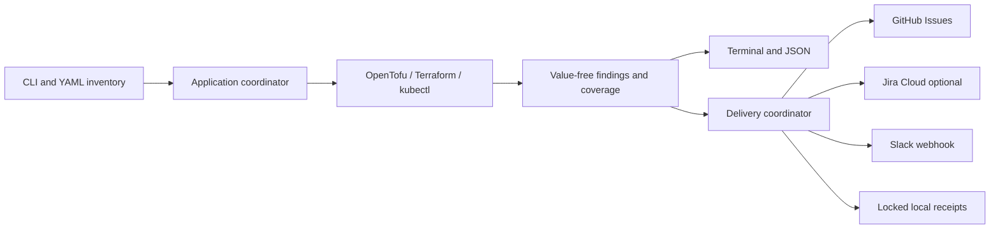

# infra-drift-watch

A Go CLI that detects infrastructure drift and reports it through terminal/JSON
output, GitHub issues, Slack, and optional Jira. Original project code is MIT licensed; no web UI.

**Status: initial implementation, not a production release.** OpenTofu and
Terraform refresh-only scanning and Kubernetes manifest comparison are implemented.
AWS and real delivery services need deployment verification; tests do not use
cloud credentials. See [verification](docs/diataxis/reference/verification.md).

## Features and boundaries

- Stable inventory target IDs, global YAML defaults, and individual overrides.
- OpenTofu/Terraform: observed changes relative to recorded state, separated from
  pending configuration changes. Workspaces must already be initialized.
- Kubernetes: server-side `kubectl diff` for explicitly supplied local manifests.
  Findings are grouped as `manifest-set`; ownership conflicts are scan failures.
- Terminal and schema-versioned JSON reports with values omitted.
- One GitHub issue per target, updated when drift changes; optional Jira Cloud.
- Slack notifications with available issue links, repeat interval, and independent receipts.
- Resolution updates and notifications; issues are never automatically closed.
- Exact-resource, expiring suppressions. Suppression makes coverage incomplete
  and prevents automatic resolution or delivery for that target.
- Single-writer local delivery state, non-root Docker image, opt-in GitHub Actions schedule.

The scanner never applies infrastructure changes or persists refreshed IaC state.
Planning may acquire backend locks. Kubernetes server-side dry-run can invoke
admission webhooks and requires appropriate RBAC. Only scan trusted workspaces:
providers, external data sources, and credential plugins can execute code.

## Quick start

Prerequisites: Linux, Go 1.27.3, Make. The module, CI, and container use Go 1.27.3.

```sh
make check
./bin/infra-drift-watch --help
./bin/infra-drift-watch validate --config examples/config.yaml --inventory examples/inventory.yaml
```

Validation checks YAML and settings without calling infrastructure or delivery
APIs, requiring credentials, or creating state. It does not prove backend access.

Use your Brew-installed tools from PATH. In an ephemeral environment that needs
provisioning, you can explicitly install pinned adapter tools (requires Go, curl,
tar, unzip, sha256sum, network):

```sh
make tools
export PATH="$PWD/.tools/bin:$PATH"
```

For the AWS example, configure AWS credentials, `TF_VAR_bucket_name`, and an existing
initialized workspace/backend. The example is illustrative and creates nothing
when validated. Follow the [AWS guide](docs/diataxis/how-to/scan-aws.md).

```sh
./bin/infra-drift-watch scan --config examples/config.yaml --inventory examples/inventory.yaml --dry-run
./bin/infra-drift-watch scan --config examples/config.yaml --inventory examples/inventory.yaml --target aws-demo --format json
```

Dry-run still inspects live infrastructure. It skips all destination calls and
local receipt writes. Delivery is disabled in the supplied example configuration.

| Exit | Meaning |
| --- | --- |
| 0 | Successful scan with no drift in inspected scope |
| 1 | Configuration, scan, coverage, delivery, or output failure |
| 2 | Successful scan; drift detected |

Failures take precedence across multiple targets. Reports preserve per-target results.

## Configuration and inventory

Use [examples/config.yaml](examples/config.yaml) and
[examples/inventory.yaml](examples/inventory.yaml). Precedence is built-in defaults,
global settings, target overrides, then explicit CLI flags. Nested destination
settings merge; lists/maps replace. Explicit false disables an inherited destination.
Empty strings inherit; empty lists/maps clear inherited collections.

Paths in inventory are relative to the inventory file; variable files are relative
to the workspace. State paths are relative to the global config file unless
`--state-dir` is supplied (then relative to the current directory).

See [all settings](docs/diataxis/reference/configuration.md),
[CLI reference](docs/diataxis/reference/cli.md), and
[delivery setup](docs/diataxis/how-to/configure-delivery.md).
Unknown keys, duplicate IDs, invalid durations, and unsafe API URLs are rejected.
Credentials are referenced by environment-variable name, never stored in YAML.

## Architecture



[arc42 architecture](docs/arc42/index.md) contains C4 context/building-block views
and Mermaid runtime/deployment diagrams. [ADRs](docs/adr/index.md) record decisions.

## Docker

```sh
make docker-build
docker run --rm infra-drift-watch:dev version
docker run --rm --mount type=bind,src="$PWD",dst=/work,readonly infra-drift-watch:dev validate --config examples/config.yaml --inventory examples/inventory.yaml
```

The image runs as UID/GID 65532 and bundles the versions listed in
[supported tools](docs/diataxis/reference/verification.md). For scanning, mount an
initialized workspace with the access required for backend locks and provider
execution, mount a writable state directory at `/state`, and use `--state-dir /state`.
Supply credentials at runtime. Kubernetes needs a mounted kubeconfig and any
credential plugin it references. Plan creation needs a writable temporary directory.
Never bake secrets into images. [Third-party notices](THIRD_PARTY_NOTICES.md)
and license texts are included in the image. OpenTofu uses MPL-2.0; the bundled
Terraform release uses BSL-1.1 and its additional use grant. The image's components
are not all covered by the application's MIT license.

## GitHub Actions

Validation runs on pull requests targeting develop/main and on workflow_dispatch,
never on push. Separate jobs check Go formatting, lint, vet, module integrity,
race tests/build, documentation, OKF knowledge, Mermaid, OpenSpec, native adapters,
and the runtime container. Release publishing is manual workflow_dispatch with an
existing version tag on main; pushing a branch or tag does not publish a release.
Dependabot proposes weekly Go/npm/action/container updates into develop.


[Scheduled scan](.github/workflows/scan.yml) runs every six hours in UTC only when
`DRIFT_SCAN_ENABLED=true`. It uses GitHub-hosted runners, AWS OIDC, one writer,
best-effort receipt caching, and report artifacts. Configure the destination,
backend, secrets, and repository variables before enabling it.

See [workflow setup](docs/diataxis/how-to/github-actions.md). Schedules use the
repository default branch; development remains on `develop`. Nothing has been
deployed or enabled remotely by creating these files.

## Development: TDD

Feature/fix PRs target `develop`; release PRs promote to `main`.
Write a meaningful failing test, confirm why it fails, implement, then refactor.
Bug fixes start with a reproducing regression test. See [AGENTS.md](AGENTS.md)
and [CONTRIBUTING.md](CONTRIBUTING.md).

| Command | Purpose |
| --- | --- |
| `make check` | Formatting, vet, module integrity, race tests, build, docs/OKF checks |
| `make test` | Unit and mocked integration tests |
| `make test-race` | Race-enabled tests |
| `make test-integration` | Real OpenTofu/Terraform tests using installed tools |
| `make test-kubernetes` | Disposable cluster test; requires kind, kubectl, Docker |
| `make fmt` / `make fmt-check` | Format / check Go source |
| `make vet` / `make lint` | Go vet / golangci-lint from PATH |
| `make lint-docker` | Run pinned golangci-lint in a container; no host install |
| `make vuln` | Run govulncheck from PATH |
| `make docs-check` | Documentation links and workflow YAML |
| `make knowledge-check` | Knowledge links and OKF metadata |
| `make openspec-check` | Strict OpenSpec validation using openspec from PATH |
| `make mermaid-check` | Real Mermaid parsing; requires npm ci --prefix scripts/mermaid --ignore-scripts |
| `make tools` | Explicit download of checksum-verified runtime executables |
| `make kind-tools` | Explicit install of pinned kind for disposable cluster checks |
| `make dev-tools` | Explicit installation of pinned Go verification tools |
| `make docker-build` | Build the bundled runtime image |

Local checks and integration tests use your installed tools from PATH; ignored
.tools/bin copies never take precedence automatically. Verification executables
can be overridden with GOVULNCHECK, ACTIONLINT, GOLANGCI_LINT, and OPENSPEC.
`make check` is offline after Go dependencies are cached. Mermaid parsing,
vulnerability checks, and tool integration are separate CI steps with explicit
prerequisites. No live cloud or notifications are needed for normal tests.

## Documentation and next work

- [Documentation index](docs/index.md): Diátaxis guides and reference.
- [Knowledge](knowledge/index.md): indexed OKF domain concepts and policies.
- [OpenSpec](openspec/specs/cli/spec.md): behavior and acceptance scenarios.
- [Intake](docs/diataxis/explanation/project-intake.md): original requirements.

Before a production release: verify AWS backend/permissions and real destinations,
confirm supported tool versions in your environment, and choose stronger state
retention if notification duplicates are unacceptable. Future features can include
per-field Kubernetes findings, richer history, and configurable issue closure.
There is no persistent daemon, distributed locking, or exactly-once delivery.

## Security and license

Reports omit values; ephemeral plan files use a private directory and are removed
on normal exits. Tool errors are summarized rather than exposing raw stderr.
Process crashes may leave temporary artifacts; use isolated runners and temporary storage.
Resource names, owners, and environment labels are still operational metadata.
The project's original code is [MIT licensed](LICENSE). OpenTofu, Terraform,
providers, linked libraries, and OS packages retain separate terms. See
[third-party notices](THIRD_PARTY_NOTICES.md), the
[license comparison](docs/diataxis/explanation/licensing.md), and
[security reporting](SECURITY.md). Manual releases include a license/notices archive.
