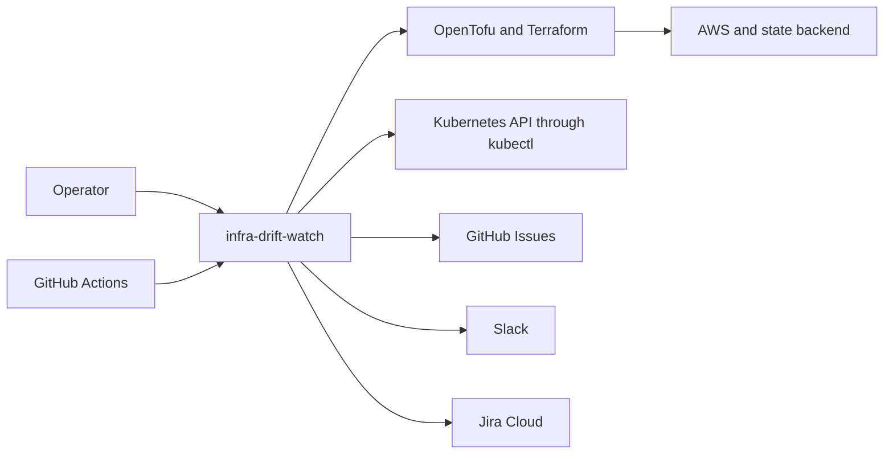

# Context and scope

Operators supply inventory and config; GitHub Actions schedules scans. External infrastructure tools inspect AWS/state or Kubernetes. Delivery writes GitHub/Jira issues and Slack messages.

This is the C4 system context view. All infrastructure and delivery destinations are external systems.
