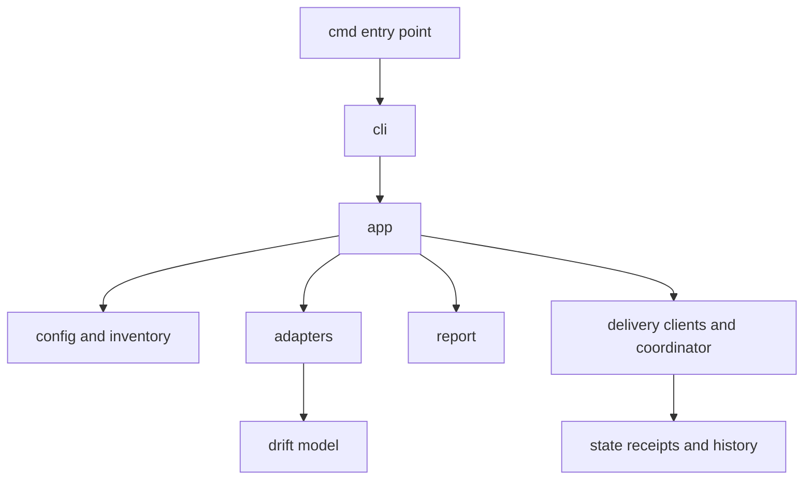

# Containers and components

C4 levels 2 and 3.

One binary is the sole C4 application container; the filesystem receipt store is its local data store. Internal packages form the C4 component view:

Configuration loading owns validation/override resolution. Adapters own comparison semantics. Delivery files separate HTTP, GitHub, Jira and coordination responsibilities without a plugin framework. State owns lock and atomic persistence.

[C4 views](index.md)
