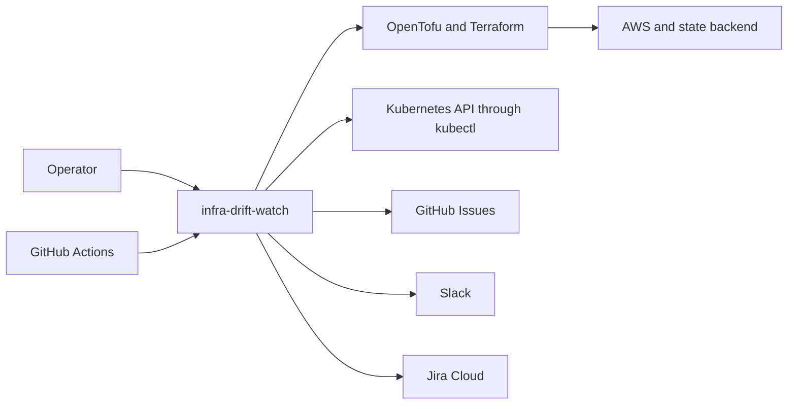

# System context

C4 level 1: the scanner, the people and systems that start it, and the systems it inspects and writes to.

Operators supply inventory and config; GitHub Actions schedules scans. External infrastructure tools inspect AWS/state or Kubernetes. Delivery writes GitHub/Jira issues and Slack messages.

All infrastructure and delivery destinations are external systems.

[C4 views](index.md)
