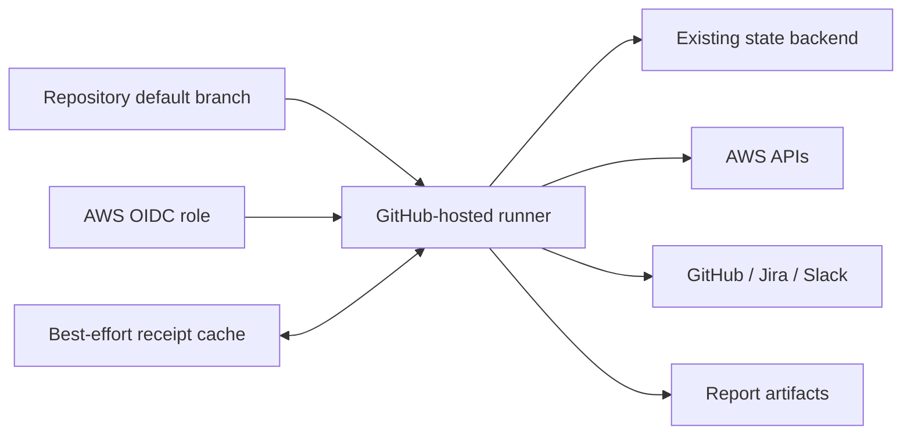

# Deployment

The C4 deployment view.

GitHub-hosted Linux runners obtain AWS credentials through OIDC, initialize an existing workspace, restore receipts, scan, and save state/report artifacts. The schedule is opt-in and resides on the default branch.

The Docker alternative bundles pinned native tools and runs as UID/GID 65532. Mount configuration, workspace, credentials and writable state intentionally. There is no deployed server.

Validation jobs run on PRs and manual dispatch; draft release generation is manual. Only the separately configured drift scan has a schedule.

[C4 views](index.md)
