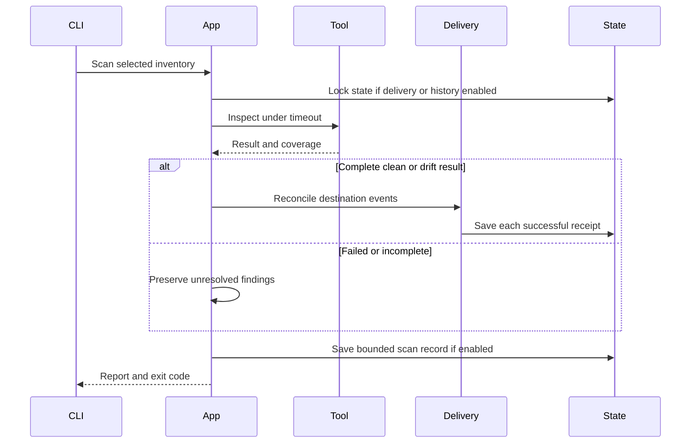

# Runtime

A C4 dynamic view of one scan.

Validation performs no remote calls. Scan preflights enabled destination credentials and locks state before inspection. A failed target remains visible while later targets continue.

Explicit dry-run skips delivery, credential preflight and receipt and history writes, but still inspects infrastructure.

[C4 views](index.md)
