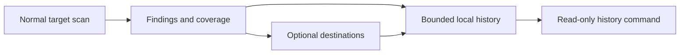

# Inspect scan history

Normal scans persist a bounded, value-free record even if delivery is disabled.
History defaults to enabled with 100 records per target. Override it in global
settings or the target's settings:

```yaml
defaults:
  history:
    enabled: true
    limit: 100
```

```sh
bin/infra-drift-watch history --state-dir .state --target aws-demo --limit 20
bin/infra-drift-watch history --state-dir .state --format json
```

The command reads an existing atomic snapshot; it requires no inventory,
credentials, cloud access or delivery calls, and never creates or writes state.
A live writer does not block reads of its last complete snapshot. An absent or
invalid state file returns an error. Results are newest first.

Records include scan time, inspection duration, scope outcome, resource/field
findings, suppressed count, safe errors, delivery errors, and an opaque change
fingerprint. Raw infrastructure values and process stderr are never stored.
The fingerprint lets you compare findings without retaining their values.

Failed/incomplete scans are history events, not proof of resolution. A failed
history write fails the scan command and appears in history_errors in the current
report. Configuration or credential preflight errors occur before inspection and
do not create a scan record. Dry-run skips all receipt and history writes.



The state file now uses format version 2. Version-1 delivery receipts are preserved
in memory on open and migrated atomically on the next save; readers accept both
versions. Older application versions cannot read version 2. Back up your state
before upgrading if you need to roll back the application.

Retention is enforced per target when its next record is saved. Disabling history
stops appending records but does not erase earlier records. Removed targets retain
their last bounded records. Store the directory persistently if history must
survive ephemeral runners. GitHub Actions cache can be evicted; this is local
bounded history, not a distributed database or guaranteed historical archive.
